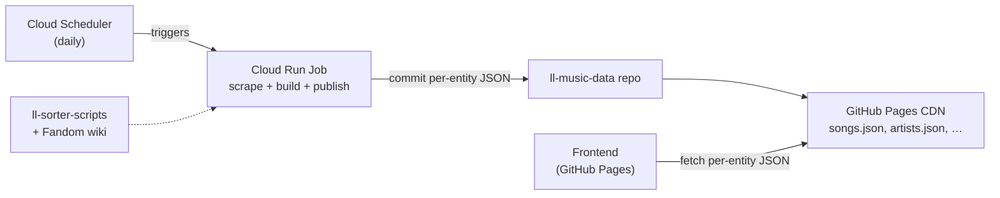

# LL Music Reactions

A web app for creating Love Live music reaction meme videos. Match songs from the Love Live discography with reaction video clips, arrange them on a timeline, and export a stitched MP4 with album art overlays.

## Features

- **Song Search** — Fuzzy search across 871 songs with romaji/hiragana/English support
- **Series Filters** — Filter by franchise (μ's, Aqours, Nijigaku, Liella, etc.), artist, or year
- **Clip Library** — Pre-bundled reaction clips searchable by name and emotion tags
- **Drag-and-Drop Timeline** — Arrange clip+song pairs in sequence
- **Setlist Loader** — Load concert setlists (720 performances) as templates
- **Video Preview** — Play through your sequence with album art corner overlay
- **Client-Side MP4 Export** — Video stitching runs 100% in your browser via WebCodecs (`VideoEncoder` + `AudioEncoder`) and `mp4-muxer` — no export server required

## Tech Stack

- React 19 + TypeScript
- Vite 6
- Tailwind CSS 4
- @dnd-kit (drag-and-drop)
- WebCodecs + Canvas2D + `mp4-muxer` (client-side H.264/AAC MP4 encoding)
- wanakana (Japanese text conversion)

## Getting Started

```bash
bun install
bun dev
```

Add reaction clips to `public/clips/` and thumbnails to `public/thumbnails/`, matching filenames in `src/data/clips-manifest.json`.

## Browser Video Export

Video compositing and MP4 encoding run entirely client-side in [`src/utils/clientExport.ts`](src/utils/clientExport.ts) using WebCodecs (`VideoEncoder` + `AudioEncoder`), Canvas2D (1:1 square cover-crop, album art, and CJK song-name labels), and `mp4-muxer`. Works in Chrome, Edge, Safari 16.4+, and Firefox 130+ with zero server dependencies or COOP/COEP headers.

## Data

Song discography data originates from the Love Live data scrapers
([hamzaabamboo/ll-sorter-scripts](https://github.com/hamzaabamboo/ll-sorter-scripts),
consumed by [hamproductions/the-sorter](https://github.com/hamproductions/the-sorter)).

The app no longer hardcodes or bundles this data. A daily **Cloud Run job**
(`pipeline/`) scrapes the catalog, builds the dataset, and commits it as
**per-entity JSON files** (`songs.json`, `artists.json`, …) to the
[`ll-music-data`](https://github.com/mting314/ll-music-data) repo, which **GitHub
Pages** serves on its global CDN. The frontend fetches those files at runtime from
`VITE_DATA_BASE` (à la sekai-viewer). There is **no database and no API**, and no
bundled fallback — if the data is unreachable the app shows an error (with retry)
rather than stale data. Cost ~$0 (the job scales to zero; GitHub Pages is free).



See [`pipeline/README.md`](pipeline/README.md) for the full architecture and the
**data model (ER) diagram**.

## Contributing

This project uses [Conventional Commits](https://www.conventionalcommits.org/en/v1.0.0/) for commit messages.

Format: `<type>[optional scope]: <description>`

Examples:
```
feat: add year filter to song picker
fix: prevent timeline reorder crash on single entry
docs: update README with export instructions
refactor: extract album art resolver into utility
```

Common types: `feat`, `fix`, `docs`, `style`, `refactor`, `test`, `chore`, `build`.
